# College ERP Management System — Master Database Design Document

## 1. Document Overview
This document consolidates and formalizes the complete database architecture for the 8-module College ERP Management System based on the team's approved database specifications.

* **Database Engine:** MySQL 8.0 (InnoDB)
* **Default Collation:** `utf8mb4_unicode_ci`
* **Modules Covered:**
  1. Student Management (M1)
  2. Faculty & Staff Management (M2)
  3. Academic & Course Management (M3)
  4. Attendance Management (M4)
  5. Examination & Result Management (M5)
  6. Library Management (M6)
  7. Fees & Finance (M7)
  8. Training, Placement & Communication (M8)

---

## 2. Shared Master Entities & Inter-Module Ownership

To prevent duplication across the 23-person team, the following master entities have strict module ownership:

| Master Entity | Owning Module | Key Referencing Modules |
| :--- | :--- | :--- |
| **Department** | M2 (Faculty & Staff) | M1 (Student), M2 (Staff), M3 (Course) |
| **Faculty** | M2 (Faculty & Staff) | M2 (Department HOD), M3 (Timetable, Faculty_Subject), M4 (Attendance) |
| **Staff** | M2 (Faculty & Staff) | M6 (Librarian) |
| **Course** | M3 (Academic) | M1 (Student), M3 (Course_Subject, Section), M7 (Fee_Structure) |
| **Semester** | M3 (Academic) | M1 (Student), M3 (Course_Subject, Section, Timetable, Faculty_Subject), M5 (Exam), M7 (Fee_Structure) |
| **Subject** | M3 (Academic) | M3 (Course_Subject, Timetable, Faculty_Subject), M4 (Attendance, Attendance_Summary), M5 (Exam_Schedule) |
| **Section** | M3 (Academic) | M1 (Student), M3 (Timetable, Faculty_Subject), M4 (Attendance) |
| **Student** | M1 (Student Management) | M4 (Attendance, Attendance_Summary), M5 (Marks, Result), M6 (Book_Issue, Fine), M7 (Student_Fee, Finance_Fine), M8 (Application, Training_Enrollment) |

---

## 3. Master Entity-Relationship (ER) Diagram

```mermaid
erDiagram
    DEPARTMENT ||--o{ FACULTY : "employs"
    DEPARTMENT ||--o{ STAFF : "employs"
    DEPARTMENT ||--o{ COURSE : "offers"
    DESIGNATION ||--o{ FACULTY : "assigns"
    DESIGNATION ||--o{ STAFF : "assigns"
    STAFF ||--o| LIBRARIAN : "assigned as"

    COURSE ||--o{ COURSE_SUBJECT : "includes"
    SUBJECT ||--o{ COURSE_SUBJECT : "linked in"
    SEMESTER ||--o{ COURSE_SUBJECT : "offered in"

    COURSE ||--o{ SECTION : "has"
    SEMESTER ||--o{ SECTION : "has"

    DEPARTMENT ||--o{ STUDENT : "enrolled in"
    COURSE ||--o{ STUDENT : "enrolled in"
    SECTION ||--o{ STUDENT : "assigned to"

    STUDENT ||--o{ STUDENT_ADDRESS : "has addresses"
    STUDENT ||--o{ STUDENT_CONTACT : "has contact info"
    STUDENT ||--o{ GUARDIAN : "has guardian"
    STUDENT ||--o{ ACADEMIC_HISTORY : "has qualifications"

    FACULTY ||--o{ TIMETABLE : "assigned"
    SECTION ||--o{ TIMETABLE : "scheduled for"
    SUBJECT ||--o{ TIMETABLE : "covers"
    SEMESTER ||--o{ TIMETABLE : "scheduled in"

    FACULTY ||--o{ FACULTY_SUBJECT : "teaches"
    SUBJECT ||--o{ FACULTY_SUBJECT : "taught"
    SECTION ||--o{ FACULTY_SUBJECT : "for section"
    SEMESTER ||--o{ FACULTY_SUBJECT : "in semester"

    STUDENT ||--o{ ATTENDANCE : "marked for"
    SUBJECT ||--o{ ATTENDANCE : "class subject"
    FACULTY ||--o{ ATTENDANCE : "taken by"
    SECTION ||--o{ ATTENDANCE : "for section"

    STUDENT ||--o{ ATTENDANCE_SUMMARY : "compiled for"
    SUBJECT ||--o{ ATTENDANCE_SUMMARY : "for subject"

    SEMESTER ||--o{ EXAM : "conducted for"
    EXAM ||--o{ EXAM_SCHEDULE : "has papers"
    SUBJECT ||--o{ EXAM_SCHEDULE : "paper subject"
    EXAM_SCHEDULE ||--o{ MARKS : "contains marks"
    STUDENT ||--o{ MARKS : "scored by"
    EXAM ||--o{ RESULT : "evaluates"
    STUDENT ||--o{ RESULT : "awarded to"

    COURSE ||--o{ FEE_STRUCTURE : "fee set for"
    SEMESTER ||--o{ FEE_STRUCTURE : "fee set for"
    EXAM ||--o{ FEE_STRUCTURE : "optional exam fee"
    FEE_STRUCTURE ||--o{ STUDENT_FEE : "billed as"
    SCHOLARSHIP ||--o{ STUDENT_FEE : "discounted by"
    STUDENT ||--o{ STUDENT_FEE : "owed by"
    STUDENT_FEE ||--o{ PAYMENT : "paid via"
    STUDENT ||--o{ FINANCE_FINE : "fined for delay"

    BOOK_CATEGORY ||--o{ BOOK : "categorized as"
    PUBLISHER ||--o{ BOOK : "published by"
    BOOK ||--o{ BOOK_AUTHOR : "written by"
    AUTHOR ||--o{ BOOK_AUTHOR : "authors"
    BOOK ||--o{ BOOK_COPY : "physical copies"
    BOOK_COPY ||--o{ BOOK_ISSUE : "borrowed"
    STUDENT ||--o{ BOOK_ISSUE : "borrowed by"
    LIBRARIAN ||--o{ BOOK_ISSUE : "issued by"
    BOOK_ISSUE ||--o| BOOK_RETURN : "returned via"
    BOOK_RETURN ||--o{ FINE : "penalized via"
    STUDENT ||--o{ FINE : "fine charged to"

    COMPANY ||--o{ JOB_DRIVE : "organizes"
    JOB_DRIVE ||--o{ ELIGIBILITY : "requires"
    JOB_DRIVE ||--o{ APPLICATION : "receives"
    STUDENT ||--o{ APPLICATION : "submits"
    APPLICATION ||--o{ INTERVIEW : "has rounds"
    APPLICATION ||--o| PLACEMENT : "results in"
    TRAINING ||--o{ TRAINING_ENROLLMENT : "enrolled in"
    STUDENT ||--o{ TRAINING_ENROLLMENT : "attends"
```

---

## 4. Detailed Module Specifications

---

### MODULE 1 — STUDENT MANAGEMENT

#### 1. `Student`
Master table for all registered students.

| Attribute | Data Type | Key / Constraint | Description |
| :--- | :--- | :--- | :--- |
| `student_id` | INT AUTO_INCREMENT | PK | Unique student record identifier |
| `roll_no` | VARCHAR(30) | UNIQUE, NOT NULL | College roll number |
| `prn` | VARCHAR(30) | UNIQUE, NOT NULL | Permanent Registration Number |
| `first_name` | VARCHAR(50) | NOT NULL | First name |
| `middle_name` | VARCHAR(50) | NULL | Middle name |
| `last_name` | VARCHAR(50) | NOT NULL | Last name |
| `gender` | ENUM('Male','Female','Other') | NOT NULL | Gender |
| `dob` | DATE | NOT NULL | Date of birth |
| `category` | VARCHAR(30) | NULL | Admission category (e.g., General, OBC, SC, ST) |
| `admission_year` | YEAR | NOT NULL | Year of admission |
| `current_year` | TINYINT UNSIGNED | NOT NULL | Current study year (1, 2, 3, 4) |
| `current_semester`| TINYINT UNSIGNED | NOT NULL | Current semester (1 to 8) |
| `admission_status`| ENUM('Active','Passout','Suspended','Detained','Left') | DEFAULT 'Active' | Enrollment status |
| `phone` | VARCHAR(15) | NULL | Primary contact phone |
| `email` | VARCHAR(100) | UNIQUE, NOT NULL | Primary email |
| `password_hash` | VARCHAR(255) | NOT NULL | Securely hashed password for portal login |
| `role` | VARCHAR(20) | DEFAULT 'STUDENT' | Access control role |
| `department_id` | INT | FK -> `Department(department_id)` | Academic department |
| `course_id` | INT | FK -> `Course(course_id)` | Enrolled program |
| `section_id` | INT | FK -> `Section(section_id)`, NULL | Current class section |

#### 2. `Student_Address`
Stores address records (permanent, correspondence, local).

| Attribute | Data Type | Key / Constraint | Description |
| :--- | :--- | :--- | :--- |
| `student_address_id` | INT AUTO_INCREMENT | PK | Unique address record ID |
| `student_id` | INT | FK -> `Student(student_id)`, NOT NULL | Reference to student |
| `address_type` | ENUM('Permanent','Current','Local') | NOT NULL | Type of address |
| `street_address` | VARCHAR(255) | NOT NULL | House/building/street address |
| `city` | VARCHAR(50) | NOT NULL | City |
| `state` | VARCHAR(50) | NOT NULL | State |
| `pincode` | VARCHAR(10) | NOT NULL | Postal PIN code |

#### 3. `Student_Contact`
Detailed emergency and secondary communication details.

| Attribute | Data Type | Key / Constraint | Description |
| :--- | :--- | :--- | :--- |
| `contact_id` | INT AUTO_INCREMENT | PK | Unique contact ID |
| `student_id` | INT | FK -> `Student(student_id)`, NOT NULL | Reference to student |
| `mobile_number` | VARCHAR(15) | NOT NULL | Mobile number |
| `alternate_mobile` | VARCHAR(15) | NULL | Secondary mobile number |
| `personal_email` | VARCHAR(100) | NULL | Personal email address |
| `institute_email` | VARCHAR(100) | NULL | Official college email address |

#### 4. `Guardian`
Parent and local guardian records.

| Attribute | Data Type | Key / Constraint | Description |
| :--- | :--- | :--- | :--- |
| `guardian_id` | INT AUTO_INCREMENT | PK | Unique guardian ID |
| `student_id` | INT | FK -> `Student(student_id)`, NOT NULL | Reference to student |
| `guardian_name` | VARCHAR(100) | NOT NULL | Full name of guardian |
| `relation` | VARCHAR(30) | NOT NULL | Relationship (Father, Mother, Local Guardian) |
| `occupation` | VARCHAR(50) | NULL | Profession/Occupation |
| `contact_number` | VARCHAR(15) | NOT NULL | Phone number |
| `email` | VARCHAR(100) | NULL | Email address |

#### 5. `Academic_History`
Past academic qualifications (10th, 12th, Diploma, etc.).

| Attribute | Data Type | Key / Constraint | Description |
| :--- | :--- | :--- | :--- |
| `academic_history_id`| INT AUTO_INCREMENT | PK | Unique history ID |
| `student_id` | INT | FK -> `Student(student_id)`, NOT NULL | Reference to student |
| `qualification_level`| VARCHAR(50) | NOT NULL | e.g. "10th", "12th/HSC", "Diploma" |
| `institute_name` | VARCHAR(150) | NOT NULL | School / College attended |
| `board_university` | VARCHAR(100) | NOT NULL | Examination board or university |
| `percentage_gpa` | DECIMAL(5,2) | NOT NULL | Marks percentage or GPA |
| `passing_year` | YEAR | NOT NULL | Year of completion |

---

### MODULE 2 — FACULTY & STAFF MANAGEMENT

#### 6. `Department` (Master table owned by M2)
Core academic and administrative departments.

| Attribute | Data Type | Key / Constraint | Description |
| :--- | :--- | :--- | :--- |
| `department_id` | INT AUTO_INCREMENT | PK | Unique department identifier |
| `department_name` | VARCHAR(100) | UNIQUE, NOT NULL | Department name (e.g. Computer Science) |
| `location` | VARCHAR(100) | NULL | Building / floor location |
| `hod_faculty_id` | INT | FK -> `Faculty(faculty_id)`, NULL | Head of Department |

#### 7. `Designation`
Job roles and salary scale designations for teaching and non-teaching staff.

| Attribute | Data Type | Key / Constraint | Description |
| :--- | :--- | :--- | :--- |
| `designation_id` | INT AUTO_INCREMENT | PK | Unique designation ID |
| `designation_name` | VARCHAR(100) | UNIQUE, NOT NULL | e.g. "Professor", "Assistant Professor", "Clerk" |
| `category` | ENUM('Teaching','Non-Teaching') | NOT NULL | Staff classification |

#### 8. `Faculty` (Master shared entity owned by M2)
Teaching staff members.

| Attribute | Data Type | Key / Constraint | Description |
| :--- | :--- | :--- | :--- |
| `faculty_id` | INT AUTO_INCREMENT | PK | Unique faculty identifier |
| `faculty_code` | VARCHAR(30) | UNIQUE, NOT NULL | Employee code / badge ID |
| `first_name` | VARCHAR(50) | NOT NULL | First name |
| `middle_name` | VARCHAR(50) | NULL | Middle name |
| `last_name` | VARCHAR(50) | NOT NULL | Last name |
| `email` | VARCHAR(100) | UNIQUE, NOT NULL | Email address |
| `phone_no` | VARCHAR(15) | NULL | Mobile contact number |
| `password_hash` | VARCHAR(255) | NOT NULL | Securely hashed password for portal login |
| `role` | VARCHAR(20) | DEFAULT 'FACULTY' | Access control role |
| `department_id` | INT | FK -> `Department(department_id)`, NOT NULL | Assigned department |
| `designation_id` | INT | FK -> `Designation(designation_id)`, NOT NULL | Job title/rank |
| `joining_date` | DATE | NOT NULL | Date of joining |
| `qualification` | VARCHAR(100) | NULL | Highest degree (Ph.D, M.Tech, etc.) |
| `status` | ENUM('Active','On Leave','Resigned','Retired') | DEFAULT 'Active' | Service status |

#### 9. `Staff`
Non-teaching and administrative staff members.

| Attribute | Data Type | Key / Constraint | Description |
| :--- | :--- | :--- | :--- |
| `staff_id` | INT AUTO_INCREMENT | PK | Unique staff identifier |
| `first_name` | VARCHAR(50) | NOT NULL | First name |
| `middle_name` | VARCHAR(50) | NULL | Middle name |
| `last_name` | VARCHAR(50) | NOT NULL | Last name |
| `email` | VARCHAR(100) | UNIQUE, NOT NULL | Email address |
| `phone_no` | VARCHAR(15) | NULL | Contact phone number |
| `password_hash` | VARCHAR(255) | NOT NULL | Securely hashed password for portal login |
| `role` | VARCHAR(20) | DEFAULT 'STAFF' | Access control role |
| `department_id` | INT | FK -> `Department(department_id)`, NOT NULL | Department |
| `designation_id` | INT | FK -> `Designation(designation_id)`, NOT NULL | Designation |
| `joining_date` | DATE | NOT NULL | Date of joining |
| `status` | ENUM('Active','On Leave','Resigned','Retired') | DEFAULT 'Active' | Service status |

#### 10. `Salary`
Payroll calculation and payment history.

| Attribute | Data Type | Key / Constraint | Description |
| :--- | :--- | :--- | :--- |
| `payroll_id` | INT AUTO_INCREMENT | PK | Unique payroll record ID |
| `employee_type` | ENUM('Faculty','Staff') | NOT NULL | Classification of employee |
| `employee_id` | INT | NOT NULL | References `faculty_id` or `staff_id` |
| `basic_salary` | DECIMAL(10,2) | NOT NULL | Base monthly salary |
| `allowance` | DECIMAL(10,2) | DEFAULT 0.00 | Allowances (DA, HRA, TA) |
| `deduction` | DECIMAL(10,2) | DEFAULT 0.00 | Deductions (PF, Tax, Insurance) |
| `net_salary` | DECIMAL(10,2) | NOT NULL | Final paid amount |
| `payment_date` | DATE | NULL | Date disbursed |
| `payment_status` | ENUM('Pending','Paid','Failed') | DEFAULT 'Pending' | Status of payment |
| `payment_mode` | ENUM('Bank Transfer','Cheque','Cash') | DEFAULT 'Bank Transfer' | Disbursement mode |

---

### MODULE 3 — ACADEMIC & COURSE MANAGEMENT

#### 11. `Course`
Degree programs offered (e.g. B.Tech Computer Engineering, M.Tech, BBA).

| Attribute | Data Type | Key / Constraint | Description |
| :--- | :--- | :--- | :--- |
| `course_id` | INT AUTO_INCREMENT | PK | Unique course ID |
| `course_code` | VARCHAR(30) | UNIQUE, NOT NULL | Program code (e.g. "BTECH-CS") |
| `course_name` | VARCHAR(100) | NOT NULL | Name of program |
| `course_type` | ENUM('UG','PG','Diploma','Doctorate') | NOT NULL | Degree level |
| `duration_years` | TINYINT UNSIGNED | NOT NULL | Duration in years |
| `total_credits` | INT UNSIGNED | NOT NULL | Required graduation credits |
| `department_id` | INT | FK -> `Department(department_id)`, NOT NULL | Offering department |
| `status` | ENUM('Active','Discontinued') | DEFAULT 'Active' | Course status |

#### 12. `Subject`
Individual curriculum subjects (e.g. Data Structures, DBMS, Operating Systems).

| Attribute | Data Type | Key / Constraint | Description |
| :--- | :--- | :--- | :--- |
| `subject_id` | INT AUTO_INCREMENT | PK | Unique subject ID |
| `subject_code` | VARCHAR(30) | UNIQUE, NOT NULL | Subject code (e.g. "CS301") |
| `subject_name` | VARCHAR(100) | NOT NULL | Subject name |
| `subject_type` | ENUM('Theory','Practical','Elective','Seminar') | NOT NULL | Subject type |
| `credits` | TINYINT UNSIGNED | NOT NULL | Credit value |
| `lecture_hours` | TINYINT UNSIGNED | DEFAULT 0 | Weekly lecture hours |
| `tutorial_hours`| TINYINT UNSIGNED | DEFAULT 0 | Weekly tutorial hours |
| `practical_hours`| TINYINT UNSIGNED | DEFAULT 0 | Weekly lab hours |
| `status` | ENUM('Active','Inactive') | DEFAULT 'Active' | Subject status |

#### 13. `Semester`
Academic terms (e.g. Fall 2026, Semester 3 - 2026-27).

| Attribute | Data Type | Key / Constraint | Description |
| :--- | :--- | :--- | :--- |
| `semester_id` | INT AUTO_INCREMENT | PK | Unique semester ID |
| `semester_number`| TINYINT UNSIGNED | NOT NULL | Semester number (1 to 8) |
| `semester_name` | VARCHAR(50) | NOT NULL | e.g. "Semester 5" |
| `academic_year` | VARCHAR(20) | NOT NULL | e.g. "2026-2027" |
| `start_date` | DATE | NOT NULL | Semester begin date |
| `end_date` | DATE | NOT NULL | Semester end date |
| `status` | ENUM('Upcoming','Ongoing','Completed') | DEFAULT 'Upcoming' | Term status |

#### 14. `Course_Subject`
Mapping of subjects to specific courses, semesters, and curriculum orders.

| Attribute | Data Type | Key / Constraint | Description |
| :--- | :--- | :--- | :--- |
| `course_subject_id` | INT AUTO_INCREMENT | PK | Unique mapping ID |
| `course_id` | INT | FK -> `Course(course_id)`, NOT NULL | Course program |
| `subject_id` | INT | FK -> `Subject(subject_id)`, NOT NULL | Subject |
| `semester_id` | INT | FK -> `Semester(semester_id)`, NOT NULL | Academic term |
| `subject_order` | TINYINT UNSIGNED | DEFAULT 1 | Display sequence in syllabus |
| `is_elective` | BOOLEAN | DEFAULT FALSE | Whether elective subject |
| `academic_year` | VARCHAR(20) | NOT NULL | Curriculum revision year |
| `status` | ENUM('Active','Inactive') | DEFAULT 'Active' | Curriculum status |

#### 15. `Section`
Class divisions / batches within a course and semester (e.g. Div A, Div B).

| Attribute | Data Type | Key / Constraint | Description |
| :--- | :--- | :--- | :--- |
| `section_id` | INT AUTO_INCREMENT | PK | Unique section ID |
| `section_name` | VARCHAR(30) | NOT NULL | Section name (e.g. "A", "B") |
| `batch_name` | VARCHAR(50) | NULL | Batch label (e.g. "2024-2028") |
| `course_id` | INT | FK -> `Course(course_id)`, NOT NULL | Course program |
| `semester_id` | INT | FK -> `Semester(semester_id)`, NOT NULL | Academic semester |
| `academic_year` | VARCHAR(20) | NOT NULL | Academic year |
| `room_no` | VARCHAR(30) | NULL | Assigned base classroom |
| `capacity` | INT UNSIGNED | DEFAULT 60 | Maximum student intake |
| `status` | ENUM('Active','Inactive') | DEFAULT 'Active' | Status |

#### 16. `Timetable`
Master weekly class timetable slots.

| Attribute | Data Type | Key / Constraint | Description |
| :--- | :--- | :--- | :--- |
| `timetable_id` | INT AUTO_INCREMENT | PK | Unique schedule slot ID |
| `section_id` | INT | FK -> `Section(section_id)`, NOT NULL | Target section |
| `subject_id` | INT | FK -> `Subject(subject_id)`, NOT NULL | Subject taught |
| `faculty_id` | INT | FK -> `Faculty(faculty_id)`, NOT NULL | Faculty instructor |
| `semester_id` | INT | FK -> `Semester(semester_id)`, NOT NULL | Current semester |
| `day_of_week` | ENUM('Monday','Tuesday','Wednesday','Thursday','Friday','Saturday') | NOT NULL | Day of week |
| `start_time` | TIME | NOT NULL | Period start time |
| `end_time` | TIME | NOT NULL | Period end time |
| `room_no` | VARCHAR(30) | NOT NULL | Classroom / Lab venue |
| `timetable_type`| ENUM('Lecture','Lab','Tutorial') | DEFAULT 'Lecture' | Session format |

#### 17. `Faculty_Subject`
Faculty teaching assignment matrix.

| Attribute | Data Type | Key / Constraint | Description |
| :--- | :--- | :--- | :--- |
| `faculty_subject_id` | INT AUTO_INCREMENT | PK | Unique assignment ID |
| `faculty_id` | INT | FK -> `Faculty(faculty_id)`, NOT NULL | Assigned faculty |
| `subject_id` | INT | FK -> `Subject(subject_id)`, NOT NULL | Assigned subject |
| `section_id` | INT | FK -> `Section(section_id)`, NOT NULL | Specific section |
| `semester_id` | INT | FK -> `Semester(semester_id)`, NOT NULL | Semester |
| `teaching_role` | ENUM('Primary','Assistant','Lab Incharge') | DEFAULT 'Primary' | Teaching responsibility |
| `assigned_date` | DATE | NOT NULL | Date assigned |
| `status` | ENUM('Active','Inactive') | DEFAULT 'Active' | Assignment status |

---

### MODULE 4 — ATTENDANCE MANAGEMENT

#### 18. `Attendance`
Daily lecture/session attendance records.

| Attribute | Data Type | Key / Constraint | Description |
| :--- | :--- | :--- | :--- |
| `attendance_id` | INT AUTO_INCREMENT | PK | Unique attendance record ID |
| `student_id` | INT | FK -> `Student(student_id)`, NOT NULL | Student marked |
| `subject_id` | INT | FK -> `Subject(subject_id)`, NOT NULL | Subject of the session |
| `faculty_id` | INT | FK -> `Faculty(faculty_id)`, NOT NULL | Faculty who took attendance |
| `section_id` | INT | FK -> `Section(section_id)`, NOT NULL | Section |
| `attendance_date` | DATE | NOT NULL | Date of session |
| `status` | ENUM('Present','Absent','Late') | NOT NULL | Attendance outcome |

#### 19. `Attendance_Summary`
Aggregated attendance metrics per student and subject for fast dashboard and eligibility queries.

| Attribute | Data Type | Key / Constraint | Description |
| :--- | :--- | :--- | :--- |
| `attendance_summary_id` | INT AUTO_INCREMENT | PK | Unique summary record ID |
| `student_id` | INT | FK -> `Student(student_id)`, NOT NULL | Student |
| `subject_id` | INT | FK -> `Subject(subject_id)`, NOT NULL | Subject |
| `total_classes` | INT UNSIGNED | DEFAULT 0 | Total lectures conducted |
| `classes_attended` | INT UNSIGNED | DEFAULT 0 | Lectures attended (Present) |
| `classes_absent` | INT UNSIGNED | DEFAULT 0 | Lectures missed (Absent) |
| `attendance_percentage` | DECIMAL(5,2) | DEFAULT 0.00 | Calculated percentage |

---

### MODULE 5 — EXAMINATION & RESULT MANAGEMENT

#### 20. `Exam`
Examination cycles and evaluation sessions (e.g. Mid-Term, End-Term, Re-Exam).

| Attribute | Data Type | Key / Constraint | Description |
| :--- | :--- | :--- | :--- |
| `exam_id` | INT AUTO_INCREMENT | PK | Unique exam cycle ID |
| `exam_name` | VARCHAR(100) | NOT NULL | Title (e.g. "End-Sem Exam Dec 2026") |
| `exam_type` | ENUM('Mid-Semester','End-Semester','Internal','Practical') | NOT NULL | Exam category |
| `academic_year` | VARCHAR(20) | NOT NULL | Academic year |
| `semester_id` | INT | FK -> `Semester(semester_id)`, NOT NULL | Target semester |

#### 21. `Exam_Schedule`
Individual date, time, and room allocations per subject in an exam term.

| Attribute | Data Type | Key / Constraint | Description |
| :--- | :--- | :--- | :--- |
| `schedule_id` | INT AUTO_INCREMENT | PK | Unique schedule ID |
| `exam_id` | INT | FK -> `Exam(exam_id)`, NOT NULL | Exam cycle |
| `subject_id` | INT | FK -> `Subject(subject_id)`, NOT NULL | Paper subject |
| `exam_date` | DATE | NOT NULL | Exam date |
| `start_time` | TIME | NOT NULL | Paper start time |
| `end_time` | TIME | NOT NULL | Paper end time |
| `room_no` | VARCHAR(30) | NOT NULL | Examination hall / room |
| `max_marks` | DECIMAL(5,2) | NOT NULL | Maximum possible marks |

#### 22. `Marks`
Individual student scores for each exam paper.

| Attribute | Data Type | Key / Constraint | Description |
| :--- | :--- | :--- | :--- |
| `mark_id` | INT AUTO_INCREMENT | PK | Unique mark record ID |
| `schedule_id` | INT | FK -> `Exam_Schedule(schedule_id)`, NOT NULL | Exam schedule |
| `student_id` | INT | FK -> `Student(student_id)`, NOT NULL | Student |
| `marks_obtained` | DECIMAL(5,2) | NOT NULL | Marks scored |
| `grade_letter` | VARCHAR(5) | NULL | Letter grade (e.g. "A+", "B") |
| `grade_point` | DECIMAL(4,2) | NULL | Grade points (e.g. 9.00) |
| `status` | ENUM('Present','Absent','Malpractice') | DEFAULT 'Present' | Evaluation status |

#### 23. `Result`
Consolidated semester grade card and performance metrics.

| Attribute | Data Type | Key / Constraint | Description |
| :--- | :--- | :--- | :--- |
| `result_id` | INT AUTO_INCREMENT | PK | Unique result record ID |
| `student_id` | INT | FK -> `Student(student_id)`, NOT NULL | Student |
| `exam_id` | INT | FK -> `Exam(exam_id)`, NOT NULL | Exam term |
| `result_date` | DATE | NOT NULL | Result publishing date |
| `sgpa` | DECIMAL(4,2) | NOT NULL | Semester Grade Point Average |
| `cgpa` | DECIMAL(4,2) | NOT NULL | Cumulative Grade Point Average |
| `overall_status` | ENUM('Pass','Fail','Withheld','ATKT') | NOT NULL | Final evaluation status |

---

### MODULE 6 — LIBRARY MANAGEMENT

#### 24. `Book_Category`
Subject classifications and genres in the library.

| Attribute | Data Type | Key / Constraint | Description |
| :--- | :--- | :--- | :--- |
| `category_id` | INT AUTO_INCREMENT | PK | Unique category ID |
| `category_name` | VARCHAR(100) | UNIQUE, NOT NULL | Category title (e.g. Computer Science) |
| `description` | TEXT | NULL | Description of category |

#### 25. `Author`
Book authors.

| Attribute | Data Type | Key / Constraint | Description |
| :--- | :--- | :--- | :--- |
| `author_id` | INT AUTO_INCREMENT | PK | Unique author ID |
| `author_name` | VARCHAR(100) | NOT NULL | Author full name |
| `email` | VARCHAR(100) | NULL | Contact email |
| `nationality` | VARCHAR(50) | NULL | Author nationality |

#### 26. `Publisher`
Publishing houses.

| Attribute | Data Type | Key / Constraint | Description |
| :--- | :--- | :--- | :--- |
| `publisher_id` | INT AUTO_INCREMENT | PK | Unique publisher ID |
| `publisher_name` | VARCHAR(150) | UNIQUE, NOT NULL | Publisher company name |
| `email` | VARCHAR(100) | NULL | Contact email |

#### 27. `Book`
Master catalog title entry identified by standard ISBN.

| Attribute | Data Type | Key / Constraint | Description |
| :--- | :--- | :--- | :--- |
| `isbn` | VARCHAR(20) | PK | International Standard Book Number |
| `title` | VARCHAR(255) | NOT NULL | Title of the book |
| `edition` | VARCHAR(30) | NULL | Edition (e.g. "3rd Edition") |
| `publication_year`| YEAR | NULL | Year published |
| `language` | VARCHAR(30) | DEFAULT 'English' | Language of publication |
| `no_of_pages` | INT UNSIGNED | NULL | Page count |
| `shelf_no` | VARCHAR(30) | NULL | Physical shelf number |
| `rack_no` | VARCHAR(30) | NULL | Physical rack number |
| `shelf_location` | VARCHAR(100) | NULL | Room / aisle location |
| `total_copies` | INT UNSIGNED | DEFAULT 0 | Total acquired copies |
| `available_copies`| INT UNSIGNED | DEFAULT 0 | Copies currently on shelf |
| `category_id` | INT | FK -> `Book_Category(category_id)`, NOT NULL | Subject category |
| `publisher_id` | INT | FK -> `Publisher(publisher_id)`, NOT NULL | Publishing house |

#### 28. `Book_Author`
Bridge table linking books with multiple authors (Many-to-Many).

| Attribute | Data Type | Key / Constraint | Description |
| :--- | :--- | :--- | :--- |
| `book_author_id` | INT AUTO_INCREMENT | PK | Unique mapping ID |
| `isbn` | VARCHAR(20) | FK -> `Book(isbn)`, NOT NULL | Book title reference |
| `author_id` | INT | FK -> `Author(author_id)`, NOT NULL | Author reference |

#### 29. `Book_Copy`
Individual physical copies of books with distinct accession barcodes.

| Attribute | Data Type | Key / Constraint | Description |
| :--- | :--- | :--- | :--- |
| `copy_id` | INT AUTO_INCREMENT | PK | Unique physical copy identifier |
| `isbn` | VARCHAR(20) | FK -> `Book(isbn)`, NOT NULL | Title reference |
| `accession_no` | VARCHAR(50) | UNIQUE, NOT NULL | Barcode / accession code |
| `purchase_date` | DATE | NOT NULL | Procurement date |
| `status` | ENUM('Available','Issued','Lost','Damaged') | DEFAULT 'Available' | Physical availability |
| `condition` | ENUM('New','Good','Fair','Poor') | DEFAULT 'Good' | Physical condition |

#### 29. `Librarian`
Links system librarian identity to Staff member.

| Attribute | Data Type | Key / Constraint | Description |
| :--- | :--- | :--- | :--- |
| `librarian_id` | INT AUTO_INCREMENT | PK | Unique librarian ID |
| `staff_id` | INT | FK -> `Staff(staff_id)`, UNIQUE, NOT NULL | Reference to Staff table |

#### 30. `Book_Issue`
Checkout circulation transactions.

| Attribute | Data Type | Key / Constraint | Description |
| :--- | :--- | :--- | :--- |
| `issue_id` | INT AUTO_INCREMENT | PK | Unique transaction ID |
| `isbn` | VARCHAR(20) | FK -> `Book(isbn)`, NOT NULL | Book title reference |
| `copy_id` | INT | FK -> `Book_Copy(copy_id)`, NOT NULL | Specific physical copy barcode |
| `student_id` | INT | FK -> `Student(student_id)`, NOT NULL | Borrower |
| `librarian_id` | INT | FK -> `Librarian(librarian_id)`, NOT NULL | Issuing desk officer |
| `issue_date` | DATE | NOT NULL | Date borrowed |
| `due_date` | DATE | NOT NULL | Return deadline |
| `issue_status` | ENUM('Issued','Returned','Overdue','Lost') | DEFAULT 'Issued' | Circulation state |
| `remarks` | TEXT | NULL | Special remarks |

#### 31. `Book_Return`
Checkin / return records.

| Attribute | Data Type | Key / Constraint | Description |
| :--- | :--- | :--- | :--- |
| `return_id` | INT AUTO_INCREMENT | PK | Unique return record ID |
| `issue_id` | INT | FK -> `Book_Issue(issue_id)`, UNIQUE, NOT NULL | Associated checkout |
| `return_date` | DATE | NOT NULL | Actual return date |
| `condition_on_return`| ENUM('Good','Damaged','Lost') | DEFAULT 'Good' | Physical condition upon receipt |
| `days_late` | INT UNSIGNED | DEFAULT 0 | Days overdue |
| `remarks` | TEXT | NULL | Return notes |

#### 32. `Fine` (Library Circulation Fine)
Fines levied due to late returns or damaged books.

| Attribute | Data Type | Key / Constraint | Description |
| :--- | :--- | :--- | :--- |
| `fine_id` | INT AUTO_INCREMENT | PK | Unique library fine ID |
| `student_id` | INT | FK -> `Student(student_id)`, NOT NULL | Student billed |
| `return_id` | INT | FK -> `Book_Return(return_id)`, NOT NULL | Return event |
| `fine_type` | ENUM('Late Return','Damage','Lost Book') | NOT NULL | Reason for fine |
| `fine_amount` | DECIMAL(8,2) | NOT NULL | Amount charged |
| `fine_date` | DATE | NOT NULL | Date fine issued |
| `paid_date` | DATE | NULL | Date cleared |
| `payment_status` | ENUM('Unpaid','Paid','Waived') | DEFAULT 'Unpaid' | Fine settlement status |

---

### MODULE 7 — FEES & FINANCE

#### 33. `Fee_Structure`
Fee schedules and institutional rates per program/semester/exam.

| Attribute | Data Type | Key / Constraint | Description |
| :--- | :--- | :--- | :--- |
| `fee_structure_id` | INT AUTO_INCREMENT | PK | Unique fee rule ID |
| `course_id` | INT | FK -> `Course(course_id)`, NOT NULL | Applicable course |
| `semester_id` | INT | FK -> `Semester(semester_id)`, NOT NULL | Applicable semester |
| `exam_id` | INT | FK -> `Exam(exam_id)`, NULL | Applicable exam (if exam fee) |
| `fee_type` | ENUM('Tuition','Exam','Hostel','Library','Laboratory','Other') | NOT NULL | Fee category |
| `amount` | DECIMAL(10,2) | NOT NULL | Standard fee amount |

#### 34. `Scholarship`
Institutional and government scholarship schemes.

| Attribute | Data Type | Key / Constraint | Description |
| :--- | :--- | :--- | :--- |
| `scholarship_id` | INT AUTO_INCREMENT | PK | Unique scholarship ID |
| `name` | VARCHAR(150) | NOT NULL | Name of grant/scheme |
| `type` | ENUM('Merit','Need-based','Sports','Government','Institutional') | NOT NULL | Category |
| `amount` | DECIMAL(10,2) | NOT NULL | Scholarship benefit amount |
| `start_date` | DATE | NOT NULL | Valid from date |
| `end_date` | DATE | NOT NULL | Valid until date |

#### 35. `Student_Fee`
Fee balance records generated for individual students.

| Attribute | Data Type | Key / Constraint | Description |
| :--- | :--- | :--- | :--- |
| `student_fee_id` | INT AUTO_INCREMENT | PK | Unique student invoice ID |
| `student_id` | INT | FK -> `Student(student_id)`, NOT NULL | Student billed |
| `fee_structure_id` | INT | FK -> `Fee_Structure(fee_structure_id)`, NOT NULL | Fee schedule reference |
| `scholarship_id` | INT | FK -> `Scholarship(scholarship_id)`, NULL | Applied waiver/scholarship |
| `amount_due` | DECIMAL(10,2) | NOT NULL | Net amount payable |
| `amount_paid` | DECIMAL(10,2) | DEFAULT 0.00 | Total amount credited |
| `status` | ENUM('Unpaid','Partially Paid','Paid') | DEFAULT 'Unpaid' | Balance status |

#### 36. `Payment`
Payment transactions executed against student fee bills.

| Attribute | Data Type | Key / Constraint | Description |
| :--- | :--- | :--- | :--- |
| `payment_id` | INT AUTO_INCREMENT | PK | Unique payment receipt ID |
| `student_fee_id` | INT | FK -> `Student_Fee(student_fee_id)`, NOT NULL | Invoice reference |
| `amount` | DECIMAL(10,2) | NOT NULL | Transaction amount |
| `payment_date` | TIMESTAMP | DEFAULT CURRENT_TIMESTAMP | Date and time received |
| `payment_mode` | ENUM('Online Gateway','Demand Draft','UPI','Cash','Bank Transfer') | NOT NULL | Payment instrument |

#### 37. `Finance_Fine`
Academic, late-payment, or administrative disciplinary fines (distinct from Library Fine).

| Attribute | Data Type | Key / Constraint | Description |
| :--- | :--- | :--- | :--- |
| `finance_fine_id` | INT AUTO_INCREMENT | PK | Unique finance fine ID |
| `student_id` | INT | FK -> `Student(student_id)`, NOT NULL | Penalized student |
| `amount` | DECIMAL(10,2) | NOT NULL | Fine penalty amount |
| `reason` | VARCHAR(255) | NOT NULL | Penalty description |
| `fine_date` | DATE | NOT NULL | Date charged |
| `payment_status` | ENUM('Pending','Paid','Waived') | DEFAULT 'Pending' | Settlement status |

---

### MODULE 8 — TRAINING, PLACEMENT & COMMUNICATION

#### 38. `Company`
Recruiting companies participating in placement seasons.

| Attribute | Data Type | Key / Constraint | Description |
| :--- | :--- | :--- | :--- |
| `company_id` | INT AUTO_INCREMENT | PK | Unique company ID |
| `company_name` | VARCHAR(150) | NOT NULL | Company name |
| `industry_type` | VARCHAR(100) | NULL | Industry sector (IT, Core, Finance, etc.) |
| `location` | VARCHAR(100) | NULL | Headquarters / drive location |
| `website` | VARCHAR(150) | NULL | Company portal URL |
| `contact_phone` | VARCHAR(20) | NULL | HR contact phone |
| `contact_email` | VARCHAR(100) | NULL | HR contact email |

#### 39. `Job_Drive`
Campus recruitment drives arranged by companies.

| Attribute | Data Type | Key / Constraint | Description |
| :--- | :--- | :--- | :--- |
| `drive_id` | INT AUTO_INCREMENT | PK | Unique drive ID |
| `company_id` | INT | FK -> `Company(company_id)`, NOT NULL | Hosting company |
| `job_role` | VARCHAR(100) | NOT NULL | Offered designation (e.g. Software Engineer) |
| `job_type` | ENUM('Full-time','Internship','Internship + PPO') | NOT NULL | Nature of position |
| `package` | VARCHAR(50) | NOT NULL | CTC / compensation (e.g. "12 LPA") |
| `drive_date` | DATE | NOT NULL | Scheduled drive date |
| `description` | TEXT | NULL | Job details and JD |

#### 40. `Eligibility`
Eligibility criteria filters for job drives.

| Attribute | Data Type | Key / Constraint | Description |
| :--- | :--- | :--- | :--- |
| `eligibility_id` | INT AUTO_INCREMENT | PK | Unique eligibility rule ID |
| `drive_id` | INT | FK -> `Job_Drive(drive_id)`, NOT NULL | Associated drive |
| `minimum_cgpa` | DECIMAL(4,2) | DEFAULT 0.00 | Minimum required CGPA |
| `backlog_allowed` | TINYINT UNSIGNED | DEFAULT 0 | Max allowable active backlogs |
| `allowed_branch` | VARCHAR(255) | NULL | Eligible departments/branches |
| `other_criteria` | TEXT | NULL | Additional criteria |

#### 41. `Application`
Student applications submitted for recruitment drives.

| Attribute | Data Type | Key / Constraint | Description |
| :--- | :--- | :--- | :--- |
| `application_id` | INT AUTO_INCREMENT | PK | Unique application ID |
| `student_id` | INT | FK -> `Student(student_id)`, NOT NULL | Applicant student |
| `drive_id` | INT | FK -> `Job_Drive(drive_id)`, NOT NULL | Target job drive |
| `application_date`| TIMESTAMP | DEFAULT CURRENT_TIMESTAMP | Submission timestamp |
| `status` | ENUM('Applied','Shortlisted','Rejected','Selected') | DEFAULT 'Applied' | Current status |

#### 42. `Interview`
Interview stages and evaluation rounds per application.

| Attribute | Data Type | Key / Constraint | Description |
| :--- | :--- | :--- | :--- |
| `interview_id` | INT AUTO_INCREMENT | PK | Unique interview round ID |
| `application_id` | INT | FK -> `Application(application_id)`, NOT NULL | Candidate application |
| `round_no` | TINYINT UNSIGNED | NOT NULL | Round sequence (1, 2, 3...) |
| `interview_date` | DATETIME | NOT NULL | Date and time of interview |
| `round_type` | ENUM('Online Assessment','Technical Round 1','Technical Round 2','HR Round','Group Discussion') | NOT NULL | Round type |
| `feedback` | TEXT | NULL | Interviewer comments |
| `status` | ENUM('Scheduled','Cleared','Not Cleared','Absent') | DEFAULT 'Scheduled' | Candidate outcome |

#### 43. `Placement`
Official placement offers extended and recorded.

| Attribute | Data Type | Key / Constraint | Description |
| :--- | :--- | :--- | :--- |
| `placement_id` | INT AUTO_INCREMENT | PK | Unique placement offer ID |
| `application_id` | INT | FK -> `Application(application_id)`, UNIQUE, NOT NULL | Approved application |
| `job_role` | VARCHAR(100) | NOT NULL | Final confirmed role |
| `package` | VARCHAR(50) | NOT NULL | Final confirmed CTC |
| `joining_date` | DATE | NULL | Date of joining |
| `status` | ENUM('Offered','Accepted','Rejected') | DEFAULT 'Offered' | Student decision |

#### 44. `Training`
Skill development workshops and industrial training modules.

| Attribute | Data Type | Key / Constraint | Description |
| :--- | :--- | :--- | :--- |
| `training_id` | INT AUTO_INCREMENT | PK | Unique training ID |
| `training_name` | VARCHAR(150) | NOT NULL | Title of training module |
| `provider` | VARCHAR(100) | NOT NULL | Conducting agency / instructor |
| `description` | TEXT | NULL | Syllabus and details |
| `start_date` | DATE | NOT NULL | Start date |
| `end_date` | DATE | NOT NULL | End date |

#### 45. `Training_Enrollment`
Student registration in specialized training programs.

| Attribute | Data Type | Key / Constraint | Description |
| :--- | :--- | :--- | :--- |
| `enrollment_id` | INT AUTO_INCREMENT | PK | Unique enrollment ID |
| `student_id` | INT | FK -> `Student(student_id)`, NOT NULL | Enrolled student |
| `training_id` | INT | FK -> `Training(training_id)`, NOT NULL | Training program |
| `enrollment_date` | DATE | NOT NULL | Registration date |
| `status` | ENUM('Enrolled','Completed','Dropped') | DEFAULT 'Enrolled' | Completion status |

#### 46. `Announcement`
Campus-wide and departmental notices and circulars.

| Attribute | Data Type | Key / Constraint | Description |
| :--- | :--- | :--- | :--- |
| `announcement_id` | INT AUTO_INCREMENT | PK | Unique announcement ID |
| `posted_by` | VARCHAR(100) | NOT NULL | Name / title of poster (e.g. "Dean Academics") |
| `title` | VARCHAR(200) | NOT NULL | Circular headline |
| `description` | TEXT | NOT NULL | Circular details |
| `announcement_date`| TIMESTAMP | DEFAULT CURRENT_TIMESTAMP | Date and time posted |

---

## 5. Architectural Alignment & Approved Decisions

### 1. Priority of Agreed Schema
All entities, exact attribute names, primary keys, and foreign keys decided by your project team have been preserved without arbitrary alterations.

### 2. Department Ownership (Module 2)
As instructed, `Department` is solely owned by **Module 2 (Faculty & Staff Management)**.
* In Module 1, `Student.department_id` references `Department(department_id)`.
* In Module 3, `Course.department_id` references `Department(department_id)`.
* `Department.hod_faculty_id` references `Faculty(faculty_id)` and is defined as nullable (`NULL`) during initial schema load to resolve the circular reference cleanly.

### 3. User Authentication (Approved Option B)
To enable secure web login for the React + Express architecture without forcing a shared credential table that alters the team's structure:
* `password_hash` (`VARCHAR(255)`) and `role` (`VARCHAR(20)`) are embedded directly into `Student`, `Faculty`, and `Staff`.
* Passwords will be hashed using industry-standard bcrypt on registration/seeding.

### 4. Book & Author Relationship (Module 6)
* A normalized `Book_Author` bridge table has been added to map books with one or more authors (`isbn` + `author_id`) in compliance with standard relational library cataloging.

### 5. Salary Employee Classification (Module 2)
* `Salary` includes `employee_type ENUM('Faculty', 'Staff')` alongside `employee_id` so payroll cleanly handles both teaching and administrative personnel.

### 6. Shared Faculty Master (Module 2)
`Faculty` is created only once in Module 2. Modules 3 (`Timetable`, `Faculty_Subject`) and 4 (`Attendance`) reference `Faculty(faculty_id)`.

### 7. Staff and Librarian Integration (Module 6)
As requested, a librarian is modeled as a member of staff: `Librarian.staff_id` references `Staff(staff_id)`.

### 8. Separation of Fines
To avoid data collisions between library circulation penalties and finance fee penalties:
* `Fine` in Module 6 records book overdue/damage fines.
* `Finance_Fine` in Module 7 records institutional fee and administrative fines.
