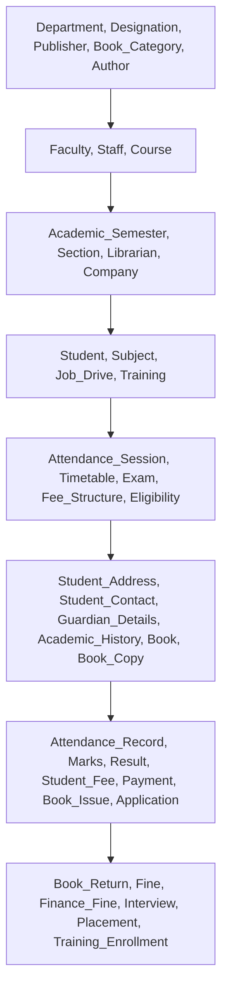

# College ERP — Data Import Validation & Integrity Guide

## 1. Scope & Objective
This guide specifies the validation rules, data-cleansing requirements, and safe execution protocol for importing CSV data from \`data_import/\` into the authoritative MySQL 8 database.

---

## 2. Identified Data Anomalies & Transformation Rules

Based on our automated inspection across all 45 CSV files in \`data_import/\`, the following format variations and edge cases were identified:

### A. Date and Time Formats
- **Observed Format in \`student.csv\`:** \`dob\` column contains dates in \`M/D/YYYY\` format (e.g. \`7/22/2006\`, \`11/5/2005\`).
- **Observed Format in Other Tables:** \`YYYY-MM-DD\` (e.g. \`2019-06-01\`, \`2026-10-10\`).
- **Required Transformation:** All date values must be parsed into ISO \`YYYY-MM-DD\` before inserting into MySQL \`DATE\` columns. If unparseable or empty, default to \`NULL\`.
- **Time Format:** Stored as \`HH:MM\` or \`HH:MM:SS\`. Target format in MySQL is \`TIME\`.

### B. Monetary and Floating Point Values
- **Observed Format:** Stored as integers or plain decimals in CSV (e.g. \`40000\`, \`12000.50\`, \`9.05\`).
- **Required Transformation:** Coerced to strict \`DECIMAL(10, 2)\` for currency amounts (fees, payments, fines, salaries) and \`DECIMAL(5, 2)\` for academic percentages and GPAs. Negative numbers or invalid strings are rejected during staging validation.

### C. Enumerations and Status Fields
- **Admission Status:** \`'Active'\`, \`'Passout'\`, \`'Suspended'\`, \`'Detained'\`, \`'Left'\`.
- **Faculty / Staff Status:** \`'Active'\`, \`'On Leave'\`, \`'Resigned'\`, \`'Retired'\`.
- **Attendance Status:** \`'Present'\`, \`'Absent'\`, \`'Late'\`.
- **Result Status:** \`'Pass'\`, \`'Fail'\`, \`'Withheld'\`, \`'ATKT'\`.
- **Required Transformation:** Strict trimming of trailing whitespace and verification against ENUM sets.

### D. User Authentication & Password Hashes
- **CSV Data State:** The original CSV files from Google Sheets contain no login credentials or password columns.
- **Security Rule:** No plaintext passwords are ever imported or written to disk. The importer will provision user accounts with secure bcrypt hashes (salt rounds: 10) defaulting to \`Student@2026\` for students and \`Faculty@2026\` for faculty members upon first provisioning.

---

## 3. Dependency-Ordered Import Hierarchy

To ensure no foreign key violation occurs during execution, tables must be loaded in the following strict dependency sequence:

1. **Tier 1 (Root Master):**
   - \`01_student/department.csv\`
   - \`02_faculty/designation.csv\`
   - \`04_library/book_category.csv\`
   - \`04_library/publisher.csv\`
   - \`04_library/author.csv\`
   - \`07_tnp/company.csv\`
   - \`08_academics_course_management/academic_semester.csv\`

2. **Tier 2 (Core Entities):**
   - \`02_faculty/faculty.csv\`
   - \`02_faculty/staff.csv\`
   - \`08_academics_course_management/course.csv\`
   - \`08_academics_course_management/subject.csv\`
   - \`01_student/section.csv\`
   - \`04_library/librarian.csv\`
   - \`07_tnp/job_drive.csv\`
   - \`07_tnp/training.csv\`

3. **Tier 3 (Master Relations):**
   - \`01_student/student.csv\`
   - \`03_exams/exam.csv\`
   - \`04_library/book.csv\`
   - \`05_finance_fee/scholarship.csv\`
   - \`05_finance_fee/fee_structure.csv\`
   - \`07_tnp/eligibility.csv\`
   - \`08_academics_course_management/faculty_subject_assignment.csv\`
   - \`08_academics_course_management/student_subject_enrollment.csv\`
   - \`08_academics_course_management/timetable.csv\`

4. **Tier 4 (Student Demographics & Library Stock):**
   - \`01_student/student_address.csv\`
   - \`01_student/student_contact.csv\`
   - \`01_student/guardian_details.csv\`
   - \`01_student/academic_history.csv\`
   - \`03_exams/exam_schedule.csv\`
   - \`04_library/book_copy.csv\`
   - \`06_attendance/attendance_session.csv\`
   - \`07_tnp/announcement.csv\`

5. **Tier 5 (Transactions):**
   - \`03_exams/marks.csv\`
   - \`03_exams/result.csv\`
   - \`04_library/book_issue.csv\`
   - \`05_finance_fee/student_fee.csv\`
   - \`06_attendance/attendance_record.csv\`
   - \`07_tnp/application.csv\`
   - \`07_tnp/training_enrollment.csv\`

6. **Tier 6 (Final Closures & Penalties):**
   - \`04_library/book_return.csv\`
   - \`04_library/fine.csv\`
   - \`05_finance_fee/payment.csv\`
   - \`05_finance_fee/finance_fine.csv\`
   - \`07_tnp/interview.csv\`
   - \`07_tnp/placement.csv\`

---

## 4. Staging and Validation Protocol

Before inserting any rows into live production tables:
1. **Pre-flight Dry Run:** Run \`node database/import_csv.js --dry-run\` which loads CSVs in memory, verifies schema types, parses all dates, tests every foreign key against parent collections, and reports any broken rows without touching the database.
2. **Duplicate Detection:** Primary keys and unique natural keys (\`prn\`, \`roll_no\`, \`email\`, \`isbn\`, \`faculty_code\`) are checked for duplicates.
3. **Transaction Wrapping:** The import script runs each batch inside an explicit SQL transaction:
   \`\`\`sql
   START TRANSACTION;
   -- Insert validated rows
   -- If any error: ROLLBACK;
   COMMIT;
   \`\`\`
4. **Non-Destructive Execution:** Uses \`INSERT IGNORE\` or \`ON DUPLICATE KEY UPDATE\` where appropriate to prevent crashes when rerun, and logs any skipped records to an import log file.

---

## 5. Rollback & Recovery Strategy
- If an import fails midway, the active transaction rolls back automatically.
- A database backup can be taken before import:
  \`\`\`cmd
  mysqldump -u root -p college_erp > college_erp_backup.sql
  \`\`\`
- Reversion script:
  \`\`\`sql
  -- Rollback tables in reverse dependency order without dropping the schema
  SET FOREIGN_KEY_CHECKS = 0;
  -- Truncate staging/transaction tables if necessary
  SET FOREIGN_KEY_CHECKS = 1;
  \`\`\`
